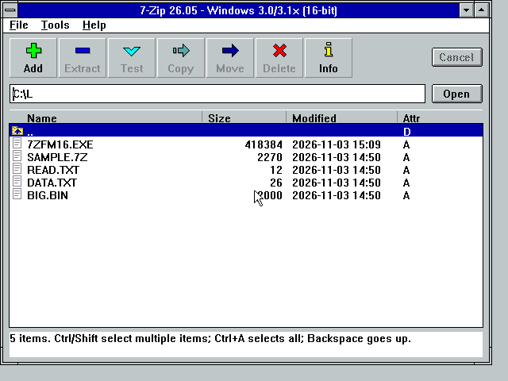
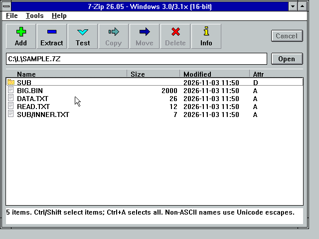

# 7-Zip 26.05 — Legacy Port

**Version 1.0** · a port of [7-Zip](https://www.7-zip.org) 26.05 to old Windows
and DOS — from the original **8088/8086** under DOS and Windows 3.0/3.1x, all the
way up through **Windows NT 3.1–4.0 / 2000 / XP (x86 & x64)**, **Windows 9x/ME**
and **Win32s**.

The 16-bit Windows GUI and the 16-bit DOS tool are a from-scratch native
implementation of the 7z/ZIP engine for the 8086; the 32-bit DOS and the NT/9x
/Win32s editions use the full, unmodified upstream 7-Zip engine.

> Independent community port. Not affiliated with or endorsed by Igor Pavlov or
> the 7-Zip project. See [License](#license).

---

## What's in the box

Four self-contained installers, one per platform (`bin/<target>/`):

| Target | Installer | Runs on | What it is |
|--------|-----------|---------|------------|
| **dos16** | `bin/dos16/7zsetd16.exe` | Any DOS, down to **8088/8086** | Native 16-bit real-mode CLI (`7Z16C.EXE`). Create 7z/ZIP/gzip/tar; list/test/extract; read xz; decrypt AES-256 7z. |
| **dos32** | `bin/dos32/7zsetd32.exe` | **386+** DOS with extended memory | Full upstream 7-Zip CLI (`7Z.EXE`, DJGPP, CWSDPMI bound in). Every built-in format and codec, including PPMd and large dictionaries. |
| **win16** | `bin/win16/7zsetw16.exe` | **Windows 3.0 / 3.1x** (8086+) | Native 16-bit file manager (`7ZFM16.EXE`). Browse, create, extract and test 7z/ZIP, checksums, associations. In Standard / 386 Enhanced mode it also creates gzip, tar and xz and AES-256-encrypted 7z. |
| **win32** | `bin/win32/7zsetw32.exe` | **NT 3.1–4.0 / 2000 / XP (x86+x64), 9x/ME, Win32s** | The real upstream 7-Zip (file manager, GUI and CLI). One installer picks the NT or the Win32s file set at run time. |

**16-bit DOS vs 32-bit DOS:** the 16-bit tool maximises hardware compatibility
(runs on an original 8088, limited formats); the 32-bit tool maximises features
(needs a 386, full engine). They are complementary, not redundant.

---

## Download and install

Each installer is a **single self-extracting `.exe`** — you do **not** need an
archiver or any other tool to install. Download just the one file for your
platform from `bin/<target>/` and run it.

**Windows (3.x / 9x / NT / Win32s)** — run the installer (Program Manager →
File → Run, or double-click in a file manager) and choose an install folder.

**DOS** — run the installer at the prompt; pass a target directory and `/S` for
an unattended install:

    7ZSETD16 C:\7-ZIP /S      (16-bit, dos16)
    7ZSETD32 C:\7-ZIP /S      (32-bit, dos32)

Every installer writes an uninstaller and an install manifest; existing files
and unrelated files are preserved.

---

## Features

- **Formats** — 7z and ZIP throughout; gzip, tar and xz on the native 16-bit
  and 32-bit builds; the full upstream format set (RAR read, many filesystem and
  disk-image formats, …) on the 32-bit DOS and NT/9x/Win32s editions.
- **AES-256** — the 16-bit GUI reads *and* (in protected mode) creates
  AES-256-encrypted 7z archives; the 16-bit CLI reads them.
- **8086-clean** — the native 16-bit objects are compiled for the 8086 ISA (no
  186+/286+ opcodes), verified by an instruction audit.
- **Report-view GUI** — the 16-bit file manager shows per-row file/folder icons
  and aligned Name / Size / Modified / Attr columns, drawn without any external
  common controls.

---

## Building from source

Full source is under `src/`. The port-specific code and build scripts live in
`src/Compat/` (`Win16/`, `DOS/`, `NT9x/`).

- **Native 16-bit (Open Watcom)** — `src/Compat/Win16/build_file_manager.sh`
  (GUI), `build_console.sh` (CLI), `build_installer.sh` (Windows installer),
  `build_dos_cli_installer.sh` (dos16 installer).
- **32-bit DOS (DJGPP + CWSDPMI)** — `src/Compat/DOS/` build scripts.
- **NT / 9x / Win32s (MinGW-w64 cross)** — see `src/Compat/NT9x/BUILD.md`.

`verification/` holds the SHA-256 sums of the shipped installers, the NT/Win32s
regression matrix and the payload manifests.

---

## License

7-Zip is **Copyright © 1999-2026 Igor Pavlov** and is free software under the
**GNU LGPL** (with the unRAR restriction on RAR code and BSD terms for a few
decoders). This port is released under the same terms (LGPL-2.1-or-later).

See [`LICENSE`](LICENSE) for the summary and [`LICENSE-7zip.txt`](LICENSE-7zip.txt)
for the full, verbatim 7-Zip license.

**This is not an official 7-Zip release** and is not affiliated with, sponsored
by or endorsed by Igor Pavlov or the 7-Zip project. The name "7-Zip" is used
only to identify the software this port is derived from. For the official
7-Zip, visit <https://www.7-zip.org>.

## Credits

- **7-Zip** — Igor Pavlov.
- **Legacy port** — ages2001.
